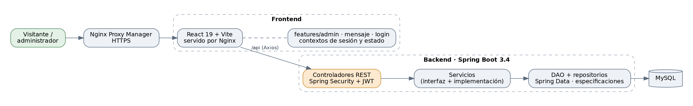

# TuFinca: aplicación web de gestión inmobiliaria

Aplicación web para publicar y administrar propiedades rurales. Los visitantes consultan propiedades, las filtran por etiquetas y envían mensajes de contacto; los administradores gestionan propiedades, contenido multimedia, etiquetas y mensajes desde un panel propio.

> Proyecto desarrollado en equipo por Catalina Gutiérrez, Camilo Millán y Santiago Castellanos (2025). El sistema llegó a desplegarse en producción como sitio de la empresa. Este repositorio es una copia del repositorio privado del equipo, publicada con su autorización; de la historia se retiraron los respaldos de la base de datos, la configuración de producción y los archivos del servidor. La sección [Participación](#participación) describe cómo se organizó el trabajo.

## Tecnologías

| Capa | Tecnología |
| --- | --- |
| Backend | Java 21, Spring Boot 3.4, Spring Security con JWT, JPA |
| Frontend | React 19, Vite, Tailwind CSS, React Router, Axios |
| Base de datos | MySQL |
| Despliegue | Docker Compose, Nginx y Nginx Proxy Manager con HTTPS |

## Arquitectura



El backend separa controladores, servicios (interfaz e implementación), una capa DAO sobre los repositorios de Spring Data y especificaciones para los filtros. El frontend se organiza por funcionalidad (`features/admin`, `features/mensaje`, `features/login`) con contextos globales para la sesión y el estado compartido.

## Participación

El proyecto fue un trabajo de equipo de principio a fin: los tres integrantes planificaron el sistema, lo desarrollaron repartiéndose paquetes del backend y vistas del frontend, y evaluaron juntos los resultados.

Dentro de ese trabajo, **Santiago Castellanos** participó principalmente en:

- **Backend:** controladores, servicios y capa de persistencia de propiedades y mensajes, y el modelo de la relación entre administradores y mensajes.
- **Frontend:** el panel de administración (propiedades, formularios por secciones, etiquetas, multimedia, mensajes y perfil), la página de inicio de sesión y los contextos de autenticación y estado global.
- **Integración:** conexión del frontend con la API y corrección de errores en filtros, mensajes y carga de contenido multimedia.

## Cómo ejecutarlo

Requisitos: Docker y Docker Compose.

1. Copiar `.env.example` como `.env` y completar las contraseñas y el secreto de JWT.
2. Levantar los servicios en modo local:

   ```bash
   docker compose -f docker-compose.yml -f docker-compose.local.yml up --build
   ```

3. Abrir `http://localhost:8081`. El frontend redirige las peticiones de `/api` al backend; MySQL queda expuesto en el puerto `3307`.

La base de datos se inicializa con `database/tuFinca.sql`, que trae propiedades y etiquetas de ejemplo y un administrador de demostración (usuario `admin`, contraseña `admin123`). Las imágenes y videos de las propiedades no se incluyen en el repositorio.

En producción, el archivo `docker-compose.yml` agrega Nginx Proxy Manager como proxy inverso con HTTPS.

## Estructura

```
backend/tuFinca/   API REST en Spring Boot
frontend/          aplicación React
database/          script SQL e imagen de MySQL
docker-compose.yml          despliegue de producción
docker-compose.local.yml    ejecución local
```
